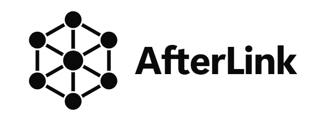
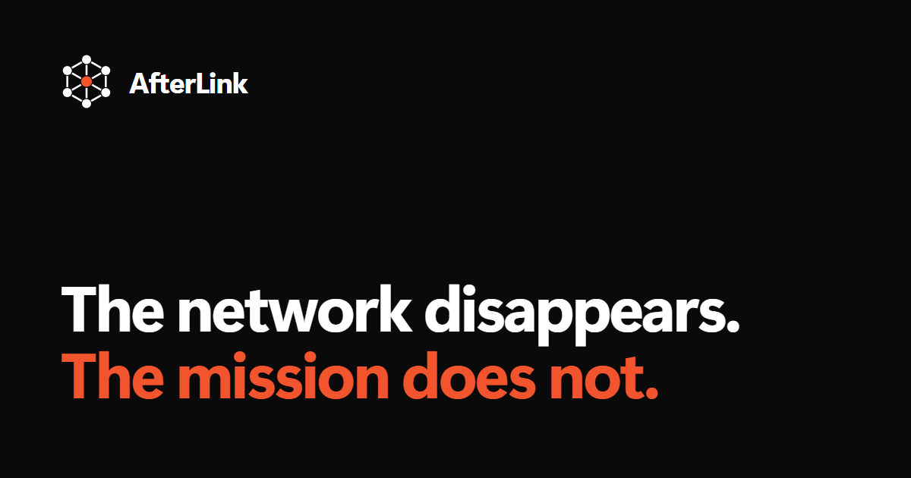
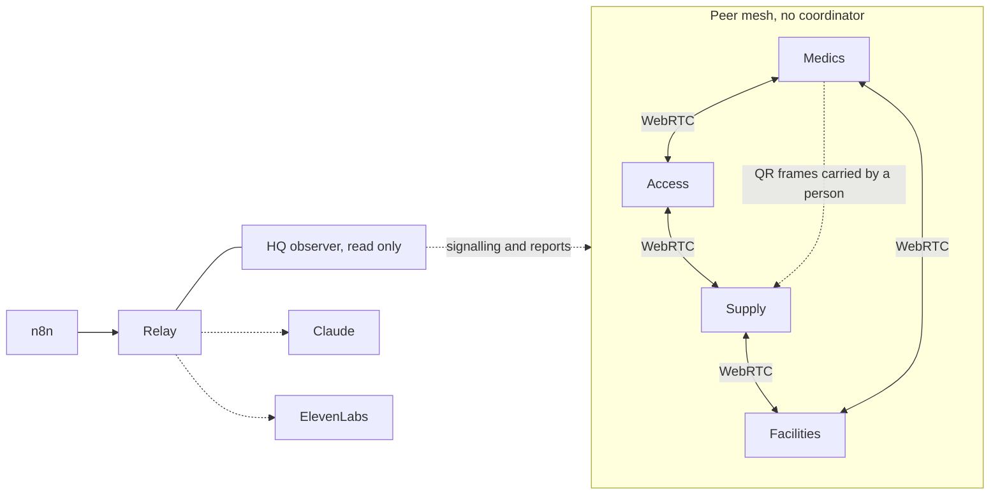

# AfterLink

<p align="center"></p>



**The network disappears. The mission does not.** AfterLink lets four volunteer teams keep working toward one shared mission after their central service dies and their devices are split into islands, then rebuilds exactly what happened when contact returns.


## Live links

| What | Where |
|---|---|
| Site | https://shafir-01.github.io/AfterLink/ |
| Relay | https://afterlink.onrender.com |
| Repository | https://github.com/shafir-01/AfterLink |
| n8n intake form | https://software.app.n8n.cloud/webhook/afterlink/request |
| Latest report from n8n | https://software.app.n8n.cloud/webhook/afterlink/report |

## You are the outage

The demo is a living festival map. Medics, Access, Facilities and Supply walk between their tasks, and glowing lines show the live peer links between them. A tower marks headquarters and says how many teams it can currently see. You then play the outage yourself.

1. **Break the network.** Drag across a line to cut it, or click the HQ tower to kill headquarters. The tower changes to "HQ down" and shows the last time it confirmed anything, and the teams keep working.
2. **Split the teams.** Cutting links leaves islands. Each island keeps accepting work, and a request dropped on the map, such as first aid, a blocked path or a wheelchair needed, is known only to the island that can hear it.
3. **See through a team's eyes.** Tap a team and the map fogs to show only what that team's own device knows, read from its own log.
4. **Request the contested resource.** Both islands ask for the last one. One commits and the other is refused, with the reason and what it can do next.
5. **Carry the update.** Drag a courier to the other group. A signed update crosses as a sequence of real QR frames that the receiving device decodes, and carrying it twice changes nothing.
6. **Restore contact.** Drag a cut line back together. With headquarters down a closed link can only reopen through signalling, so the map shows it as waiting for HQ until you restart the tower.
7. **See what happened.** The debrief shows what each team did while headquarters was blind, what was refused and why, and what is still unknown.
8. **Verify the file yourself.** Export the mission file and check it on the Verify page or on the command line. Signatures, hash chains and rights are replayed by a separate implementation, and the file is shown as valid or as exactly where it failed. Six words name the mission so two people can compare it aloud.

The whole map works by keyboard and screen reader, and on a narrow screen it gives way to a plain list of teams, links, courier routes and the tower. **Use real phones** runs the same story on separate devices.

```bash
npm install
npm run dev
```

A 90 second path is in [docs/JUDGE_RUNBOOK.md](docs/JUDGE_RUNBOOK.md) and the evidence behind each claim is in [docs/EVIDENCE.md](docs/EVIDENCE.md).

## Results

Figures come from `docs/results/SUMMARY.md` and `docs/results/headline.json`, written by the fault lab from 10200 seeded runs over 17 fault families, 200 runs per family. Each scenario runs on three systems, a central dispatcher, an offline last-write-wins board and AfterLink, with the same incidents and faults.

| Measure | Central | Board | AfterLink |
|---|---|---|---|
| Tasks done in the outage, hub dead and peers split | 2.7 | 16.1 | 15.5 |
| Priority-1 tasks done in that outage | 0.8 | 4.8 | 4.4 |
| Double-bookings per run, race for one chair | not in headline | 1.35 | 0.00 |
| Unsafe starts on a false fact per run | not in headline | 1.02 | 0.00 |
| Forged events accepted | not in headline | 397 | 0 |
| Bytes to reconcile after the split | 15 kB | 63 kB | 835 kB |

After the cut AfterLink made its first decision in 2.9 s, while the central dispatcher made none in 200 of 200 runs. AfterLink converged in 100.0% of runs after rejoining in the headline scenario.

Some results are unfavourable and we say so plainly.

- AfterLink does not out-work the offline board. Their intervals overlap on tasks done in the outage, so what separates them is safety and not throughput.
- Safety costs work in some races. In the one-chair race AfterLink finished 4.3 priority-1 tasks in the outage against 5.3 for the board, because it refused what the board double-booked.
- AfterLink is the most expensive system on the wire. Connected it sends 3688 kB per run against 487 kB for the board and 36 kB for central.
- Excluding the attack family AfterLink had no double-bookings in 3200 runs. A compromised holder of a valid key can still sign a double spend, which AfterLink detects and does not prevent.
- Every AfterLink run converged, and 9 runs raised a violation against an honest device. The lab lists each with a replay command under Known defects.

The lab uses in-memory links in virtual time and a synthetic workload, so the numbers describe that world. Replay any run with `npx tsx packages/lab/src/cli.ts --replay <family>:<seed>:<system>`.

## Resources used

| Resource | Used |
|---|---|
| Claude API credit | RESOURCES_TBD |
| ElevenLabs credits | RESOURCES_TBD |
| n8n executions | RESOURCES_TBD |
| Automated tests | RESOURCES_TBD |
| Commits | RESOURCES_TBD |

## Why it matters

At a crowded university festival the medical, access, facilities and supply teams depend on one dashboard. When it stops, a dashboard can only wait to resync, and it cannot say who may still act, whether the last AED can be promised twice, or what happened while it was blind. AfterLink answers those questions with local authority that was delegated in advance and a record that can be audited afterwards.

## Features

- Four independent actors, each with an Ed25519 identity, a signed hash chained event log and its own deterministic planner
- Direct browser to browser transport over WebRTC DataChannels, with signalling kept out of the data path
- Exclusive resources as numbered tokens, so a partition cannot allocate the same chair, AED or cart twice
- A transfer handshake that locks a token in transit when an acknowledgement is lost
- Refusals that say why, which right is missing and what the requester can do next
- Real fault injection that closes actual peer connections
- A QR ferry that carries signed, compressed deltas between groups with no electronic path, and ignores a repeated packet
- Anti-entropy sync and reconciliation that separates clean merges, policy conflicts and violations
- An observer that shows last confirmed time and a debrief of what was done while it was blind
- An exportable mission file with an independent verifier, in the browser and on the command line
- Optional Claude mission compilation and debrief narration, ElevenLabs spoken briefings, and n8n intake and reporting
- A fault lab that runs the same code against a central dispatcher and an offline task board

## Tech stack

TypeScript, ESM, npm workspaces. React and Vite for the PWA. WebRTC DataChannels for peer links. Noble cryptography libraries for Ed25519 and SHA-256 so Node and every browser behave the same. IndexedDB for device storage. jsQR and chunked QR frames for the ferry. Hono and ws for the relay. Vitest and fast-check for tests. Playwright for browser tests.

## Getting started

Prerequisites are Node 22 or newer and npm.

```bash
git clone https://github.com/shafir-01/AfterLink.git
cd AfterLink
npm install
npm run dev
```

The relay and the external services are optional. To use them, copy the example file and fill in the keys you have.

```bash
cp .env.example .env
npm run relay
```

| Variable | Purpose |
|---|---|
| `ANTHROPIC_API_KEY` | Mission compilation and debrief narration |
| `ELEVENLABS_API_KEY` | Spoken briefings and speech to text |
| `ELEVENLABS_VOICE_ID` | Optional voice choice |
| `N8N_WEBHOOK_URL` | Where the relay delivers outgoing reports to n8n |
| `AFTERLINK_ADMIN_TOKEN` | Token for the relay kill switch |
| `AFTERLINK_AI_ENABLED`, `AFTERLINK_DAILY_AI_CALLS` | Switch and daily ceiling for paid calls |
| `AFTERLINK_RATE_PER_MINUTE` | Per-address request limit, 120 by default |
| `AFTERLINK_WEB_ORIGIN` | Allowed browser origin for cross-origin devices |
| `PORT` | Relay port, 8787 by default |

For devices on another origin, build the web app with `VITE_RELAY_URL` pointing at the relay.

## Usage

The core packages can be used without the interface. This creates two actors, ships an event between them and checks the log.

```ts
import { generateKeys, EventLog, Author } from '@afterlink/protocol';

const keys = generateKeys();
const log = new EventLog('mission-1');
const author = new Author(keys, log);
// author.emit(type, body) signs, chains and appends an event
```

Run the fault lab to compare the three systems on the same scenarios.

```bash
npm run lab
```

Relay endpoints are `GET /health`, `GET /api/status`, `WS /signal`, `POST /api/mission/compile`, `POST /api/debrief/narrate`, `POST /api/triage`, `POST /api/voice/brief`, `POST /api/voice/transcribe`, `POST /ingress/request` and `POST /report/debrief`.

## Project structure

```
packages/
  protocol    contracts, signing, EventLog, sync summaries
  authority   token ledger, transfers, conservation
  mission     capsule, reducer, festival scenario
  planner     deterministic local decisions
  reconcile   divergence classes, mission record
  mesh        WebRTC and memory links, signalling, anti-entropy
  ferry       signed packets, QR frames
  actor       one independent actor runtime
  lab         fault simulator, baselines, experiments
apps/
  web         PWA with the stage, field device and debrief
  relay       signalling, observer, AI, voice, ingress
integrations/
  n8n         workflows and setup
docs/         architecture, evidence, limitations, runbook, experiments
```

## Architecture



Solid lines carry decisions. Dotted lines carry visibility, optional intelligence or a person with a phone. Remove every dotted line and the mesh still works. The full explanation is in [docs/ARCHITECTURE.md](docs/ARCHITECTURE.md).

## Guarantees and limits

AfterLink guarantees digital rights. A token has one holder, a transfer cannot be refunded by the sender alone, events cannot be altered or applied twice, and conservation is checked. Possession of a physical kit stays a human observation, and a device restored from an old backup can fork its own history, which is detected and shown. These are covered in [docs/KNOWN_LIMITATIONS.md](docs/KNOWN_LIMITATIONS.md).

## Testing

```bash
npm test
npm run typecheck
```

Tests cover signing and tamper detection, idempotent ingest, token conservation, the transfer lifecycle, planner behaviour, QR round trips and reconciliation. Experiment methods and raw results are in [docs/EXPERIMENTS.md](docs/EXPERIMENTS.md) and `docs/results/`.

## Deployment

The web app is a static PWA built with `npm run build` and served at the site above. The map runs on one page with nothing else needed. Multi-device mode needs the relay reachable over WebSocket, and the relay also serves the built web app with a single page fallback, so one process can host everything on one origin. The repository includes a CI workflow and a Render blueprint for the relay. Keep `.env` out of version control, set `AFTERLINK_ADMIN_TOKEN`, and use `AFTERLINK_DAILY_AI_CALLS` to cap paid calls.

## External services

Claude, ElevenLabs and n8n are optional. Each is used at runtime only through the relay, with keys held server side. None of them is in the decision path, and the product reports which are configured through `GET /api/status`.

## Roadmap

Next are revocation and late joiners, log snapshots, and a bundled TURN option for networks that block direct connections. Details are in [docs/KNOWN_LIMITATIONS.md](docs/KNOWN_LIMITATIONS.md).

## Contributing

Issues and pull requests are welcome. Run `npm test` and `npm run typecheck` before opening a pull request, and keep changes inside one package where possible.

## License

MIT. See [LICENSE](LICENSE).

## Author

shafir-01
