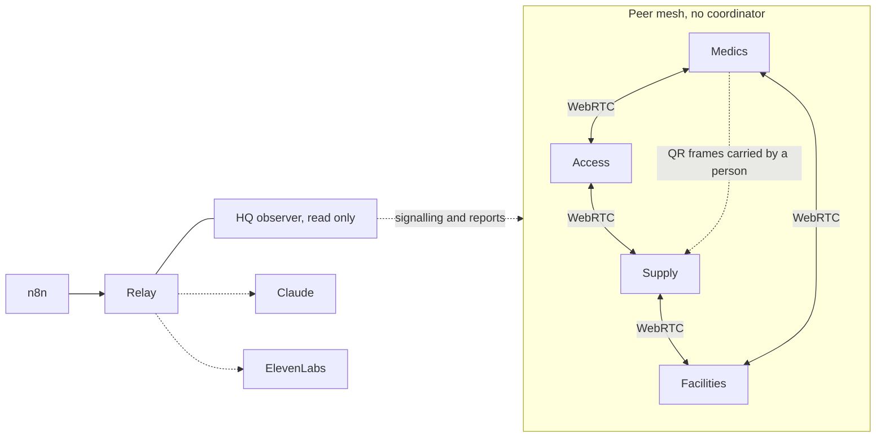

# AfterLink

**The network disappears. The mission does not.** AfterLink lets four volunteer teams keep working toward one shared mission after their central service dies and their devices are split into islands, then rebuilds exactly what happened when contact returns.


## Demo

The fastest way to see it is the solo stage, which needs no backend. Four real clients run on one page, each with its own key, storage and WebRTC connections, and a worker plays headquarters.

```bash
npm install
npm run dev
```

Select **Break the network** and the headquarters worker is terminated, yet the open peer channels keep assigning and completing work. A 90 second path through the whole story is in [docs/JUDGE_RUNBOOK.md](docs/JUDGE_RUNBOOK.md), and the evidence behind each claim is in [docs/EVIDENCE.md](docs/EVIDENCE.md).

## Why it matters

At a crowded university festival the medical, access, facilities and supply teams depend on one dashboard. When it stops, a dashboard can only wait to resync, and it cannot say who may still act, whether the last AED can be promised twice, or what happened while it was blind. AfterLink answers those questions with local authority that was delegated in advance and a record that can be audited afterwards.

## Features

- Four independent actors, each with an Ed25519 identity, a signed hash chained event log and its own deterministic planner
- Direct browser to browser transport over WebRTC DataChannels, with signalling kept out of the data path
- Exclusive resources as numbered tokens, so a partition cannot allocate the same chair, AED or cart twice
- A transfer handshake that locks a token in transit when an acknowledgement is lost
- Refusals that say why, which right is missing and what the requester can do next
- Real fault injection that closes actual peer connections
- A QR ferry that carries signed, compressed deltas between groups with no electronic path, and ignores a repeated packet
- Anti-entropy sync and reconciliation that separates clean merges, policy conflicts and violations
- An observer that shows last confirmed time and a debrief of what was done while it was blind
- Optional Claude mission compilation and debrief narration, ElevenLabs spoken briefings, and n8n intake and reporting
- A fault lab that runs the same code against a central dispatcher and an offline task board

## Tech stack

TypeScript, ESM, npm workspaces. React and Vite for the PWA. WebRTC DataChannels for peer links. Noble cryptography libraries for Ed25519 and SHA-256 so Node and every browser behave the same. IndexedDB for device storage. jsQR and chunked QR frames for the ferry. Hono and ws for the relay. Vitest and fast-check for tests. Playwright for browser tests.

## Getting started

Prerequisites are Node 22 or newer and npm.

```bash
git clone https://github.com/shafir-01/AfterLink.git
cd AfterLink
npm install
npm run dev
```

The relay and the external services are optional. To use them, copy the example file and fill in the keys you have.

```bash
cp .env.example .env
npm run relay
```

| Variable | Purpose |
|---|---|
| `ANTHROPIC_API_KEY` | Mission compilation and debrief narration |
| `ELEVENLABS_API_KEY` | Spoken briefings and speech to text |
| `ELEVENLABS_VOICE_ID` | Optional voice choice |
| `N8N_WEBHOOK_URL` | Where the relay delivers outgoing reports to n8n |
| `AFTERLINK_ADMIN_TOKEN` | Token for the relay kill switch |
| `AFTERLINK_AI_ENABLED`, `AFTERLINK_DAILY_AI_CALLS` | Switch and daily ceiling for paid calls |
| `AFTERLINK_RATE_PER_MINUTE` | Per-address request limit, 120 by default |
| `AFTERLINK_WEB_ORIGIN` | Allowed browser origin for cross-origin devices |
| `PORT` | Relay port, 8787 by default |

For devices on another origin, build the web app with `VITE_RELAY_URL` pointing at the relay.

## Usage

The core packages can be used without the interface. This creates two actors, ships an event between them and checks the log.

```ts
import { generateKeys, EventLog, Author } from '@afterlink/protocol';

const keys = generateKeys();
const log = new EventLog('mission-1');
const author = new Author(keys, log);
// author.emit(type, body) signs, chains and appends an event
```

Run the fault lab to compare the three systems on the same scenarios.

```bash
npm run lab
```

Relay endpoints are `GET /health`, `GET /api/status`, `WS /signal`, `POST /api/mission/compile`, `POST /api/debrief/narrate`, `POST /api/triage`, `POST /api/voice/brief`, `POST /api/voice/transcribe`, `POST /ingress/request` and `POST /report/debrief`.

## Project structure

```
packages/
  protocol    contracts, signing, EventLog, sync summaries
  authority   token ledger, transfers, conservation
  mission     capsule, reducer, festival scenario
  planner     deterministic local decisions
  reconcile   divergence classes, mission record
  mesh        WebRTC and memory links, signalling, anti-entropy
  ferry       signed packets, QR frames
  actor       one independent actor runtime
  lab         fault simulator, baselines, experiments
apps/
  web         PWA with the stage, field device and debrief
  relay       signalling, observer, AI, voice, ingress
integrations/
  n8n         workflows and setup
docs/         architecture, evidence, limitations, runbook, experiments
```

## Architecture



Solid lines carry decisions. Dotted lines carry visibility, optional intelligence or a person with a phone. Remove every dotted line and the mesh still works. The full explanation is in [docs/ARCHITECTURE.md](docs/ARCHITECTURE.md).

## What it guarantees and what it does not

AfterLink guarantees digital rights. A token has one holder, a transfer cannot be refunded by the sender alone, events cannot be altered or applied twice, and conservation is checked. It does not prove that a volunteer physically holds a kit, and a compromised device keeps valid keys until it is revoked. These are stated limits and not oversights, and they are listed in [docs/KNOWN_LIMITATIONS.md](docs/KNOWN_LIMITATIONS.md).

## Testing

```bash
npm test
npm run typecheck
```

Tests cover signing and tamper detection, idempotent ingest, token conservation, the transfer lifecycle, planner behaviour, QR round trips and reconciliation. Experiment methods and raw results are in [docs/EXPERIMENTS.md](docs/EXPERIMENTS.md) and `docs/results/`.

## Deployment

The web app is a static PWA built with `npm run build` and can be served from any static host. The solo stage needs nothing else. Multi-device mode needs the relay reachable over WebSocket, and the relay also serves the built web app with a single page fallback, so one process can host everything on one origin. The repository includes a CI workflow, a Render blueprint for the relay and a Vercel configuration for the static site. Keep `.env` out of version control, set `AFTERLINK_ADMIN_TOKEN`, and use `AFTERLINK_DAILY_AI_CALLS` to cap paid calls.

## External services

Claude, ElevenLabs and n8n are optional. Each is used at runtime only through the relay, with keys held server side. None of them is in the decision path, and the product reports which are configured through `GET /api/status`.

## Limitations and roadmap

Membership is fixed at provisioning, logs are not compacted, and direct connections depend on the network allowing them. Next are revocation and late joiners, log snapshots, and a bundled TURN option. Details are in [docs/KNOWN_LIMITATIONS.md](docs/KNOWN_LIMITATIONS.md).

## Contributing

Issues and pull requests are welcome. Run `npm test` and `npm run typecheck` before opening a pull request, and keep changes inside one package where possible.

## License

MIT. See [LICENSE](LICENSE).

## Author

shafir-01
