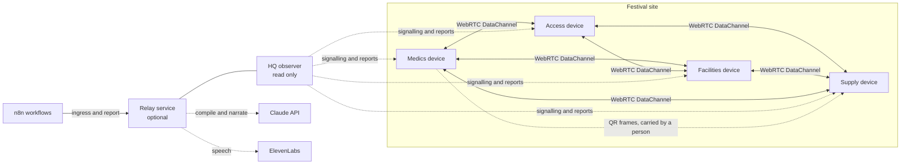
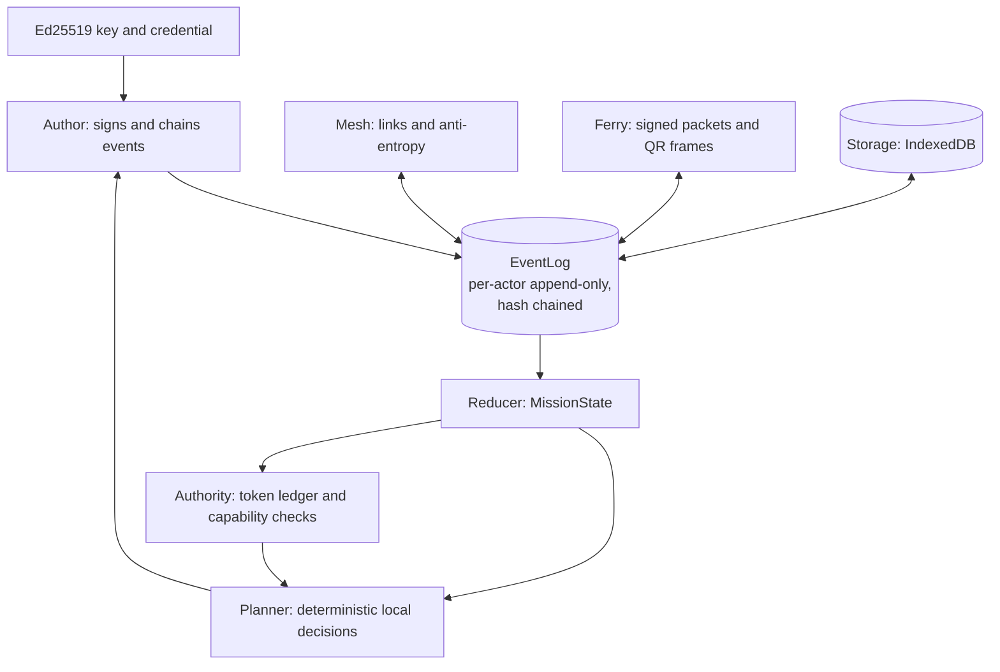

# Architecture

AfterLink is built so that no single service sits in the path of a decision. Every device is a complete actor with its own key, its own signed log and its own planner. Everything else, including the observer, the signalling service, the language model, the voice service and the workflow engine, is a boundary service that adds visibility or convenience and can disappear without stopping the mission.

## Real network paths

Solid lines carry decisions and events. Dotted lines carry only visibility, optional intelligence or a human carrying a packet. Killing every dotted line except the QR path leaves the solid mesh intact, and the mission keeps moving.

### The three transports

| Transport | Used when | What crosses it |
|---|---|---|
| WebRTC DataChannel | Peers can reach each other | Signed event envelopes and sync summaries, directly between devices |
| QR ferry | No electronic path exists | A signed packet of the events the receiver is missing, split into frames |
| Memory link | Tests and the fault lab | The same envelopes, deterministically, so protocol behaviour can be repeated exactly |

All three carry the same `EventEnvelope`. A device cannot tell from an event which road it travelled, so a ferry delivery and a live delivery of the same event are the same operation.

### Signalling is not in the data path

Two peers need a third party only to exchange connection offers. Once the DataChannel is open, bytes flow device to device. The HQ role (a signalling hub plus an observer) can therefore stop and the open channels continue. In the solo demo the HQ runs in a dedicated Web Worker and the stage kills it with `worker.terminate()`. In multi-device mode the same hub interface runs inside the Node relay and is reached over a WebSocket.

New connections after the kill need signalling again, so restoring contact means the hub returns, offers are exchanged and new channels open before anti-entropy runs.

### Faults act on real links

Partition does not set a flag. Each device closes its RTCPeerConnections to blocked peers and refuses to reconnect to them, so bytes genuinely stop. The fault plan can also add loss, duplication, delay and reordering to the link layer, which is how the lab exercises the same code the browser runs.

## One device, one actor

The loop is closed on the device. Events come in from any transport, enter the log, the reducer derives state, the planner looks at that state and what is reachable, and any action it takes becomes a new signed event. Nothing in that loop calls out of the device.

## Packages

| Package | Role |
|---|---|
| `packages/protocol` | Contracts, canonical encoding, Ed25519 signing, envelopes, Lamport clock, EventLog, sync summaries |
| `packages/authority` | Token ledger derived from events, transfers, capability checks, conservation |
| `packages/mission` | Capsule build and verify, reducer to MissionState, the festival scenario |
| `packages/planner` | Deterministic local decisions, refusals, deferrals, cover, replan |
| `packages/reconcile` | Divergence classification, mission record, reconstruction when contact returns |
| `packages/mesh` | WebRTC and memory links, signalling hub and clients, anti-entropy, fault gate |
| `packages/ferry` | Signed packets, delta selection, compression, QR frames |
| `packages/actor` | One independent actor runtime with storage and a decision loop |
| `packages/lab` | Fault simulator, baselines and experiments |
| `apps/web` | The PWA with the stage, the field device and the debrief |
| `apps/relay` | Node service for signalling, observation, AI, voice and ingress |
| `integrations/n8n` | Workflow definitions and setup |

## The event model

Every fact in the system is an `EventEnvelope` with an id that is the SHA-256 of its canonical unsigned form, a per-actor sequence number with no gaps, a hash link to the actor's previous event, causal parents from other actors, a Lamport clock, and an Ed25519 signature. Wall time is carried for display only and never decides anything.

Because ids are content hashes, a duplicate delivery is recognised and dropped, and a modified event fails verification. Because each actor's chain has no gaps, a missing event is detected as a gap and held until it arrives. Two different events with the same actor and sequence number are a fork, which is a detectable violation.

Anti-entropy exchanges a per-actor summary of heads, and each side sends only what the other lacks, in causal order.

## Authority

Exclusive resources, such as the evacuation chair, the AED and the cart, are numbered tokens issued by the signed mission capsule. A token has exactly one holder, and only the holder may commit it to a task or offer it onward.

A transfer is a handshake. `right.offered` moves the token to in-transit, and from that moment the sender cannot reclaim it alone. The recipient answers with `right.accepted` or `right.declined`. If the acknowledgement is lost, the token stays in transit, visible to everyone and refunded by nobody. This is the deliberate choice that makes a partition unable to double spend, and it costs availability in exactly the case where the system cannot know which side is right.

Conservation is checked as a standing invariant. For each resource, tokens issued equal tokens held plus in transit plus committed.

## Decisions without a leader

Every device runs the same deterministic planner over its own view of the mission. When two devices claim the same task, the claim with the lowest hash of task id and actor id wins, so both sides reach the same answer without talking. When an owner has been unreachable past the capsule's `coverAfterMs` and the task priority qualifies, a capable reachable peer may cover it. If the owner turns out to have worked too, that becomes a policy conflict for duplicate effort and not a violation, because both records are preserved.

Refusals are first-class. A `DecisionRecord` carries the outcome, a refusal code, the next steps the requester can take, one plain sentence, the governing policy, who was reachable, and the knowledge horizon at the time.

## Knowledge and staleness

Observations carry source, observed time and a validity window. The planner classifies them as confirmed, local, stale, contradicted, pending or unreachable. Reversible tasks may proceed on stale knowledge. Irreversible tasks may not, and are refused with `STALE_KNOWLEDGE`. The observer shows "last confirmed at" for a device it cannot hear from and never presents old data as current.

## Reconciliation

When links return, logs are merged by union. The classifier then separates three kinds of divergence.

| Kind | Meaning | Treatment |
|---|---|---|
| Clean | Events combine without interaction | Merged silently |
| Policy | A rule resolves it, such as duplicate effort | Resolved by the rule, both records kept |
| Violation | An invariant broke, such as a token fork or a forged event | Surfaced, never hidden |

The mission record rebuilds a timeline, marks which events the observer never saw, counts what was done while it was blind, and lists what stays unknown.

## What each service adds and what happens without it

| Service | Adds | If it is down |
|---|---|---|
| HQ observer and signalling | Visibility, new connections | Open channels keep working. New links wait for it. |
| Claude | Compiling a mission from plain language, writing the debrief narrative | Approved capsules and the planner run unchanged. A deterministic debrief remains. |
| ElevenLabs | Spoken briefings, speech to text | Briefings already cached keep playing. New ones cannot be synthesised. Text controls work throughout. |
| n8n | External intake and outward reporting | External requests stop arriving. Local decisions are unaffected. |

## Trust model

The protocol guarantees that a given event was produced by the holder of a given key, that it has not been altered, that the same event is never applied twice, and that the digital allocation of exclusive rights is conserved under the stated handshake. It does not guarantee that a volunteer physically holds the thing a token represents, and a compromised or stolen device holds real keys and can sign real events until the organiser revokes it. See [KNOWN_LIMITATIONS.md](KNOWN_LIMITATIONS.md).
